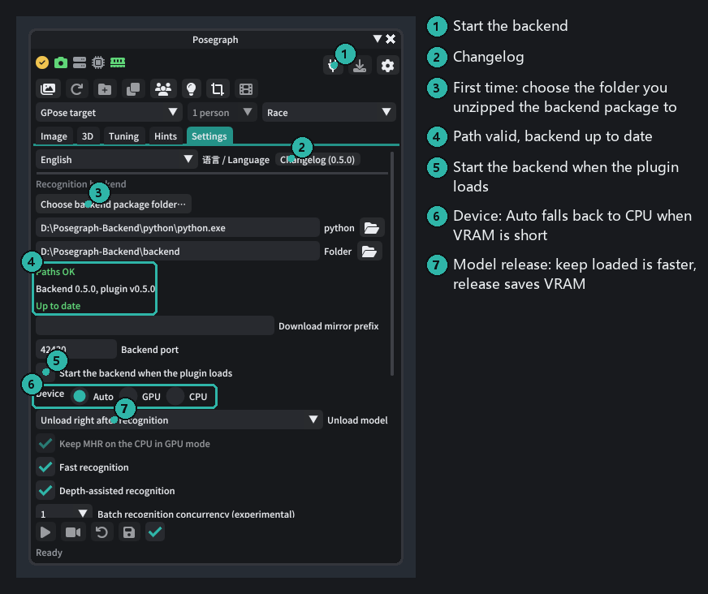
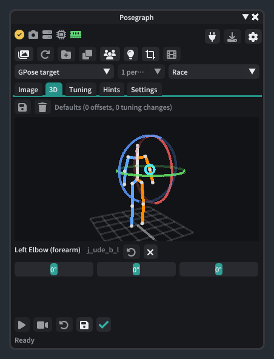
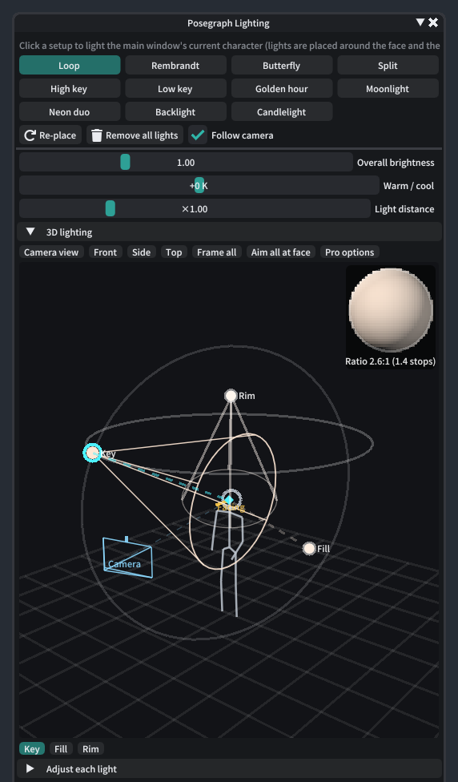
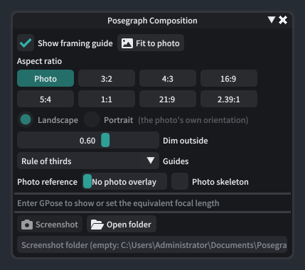
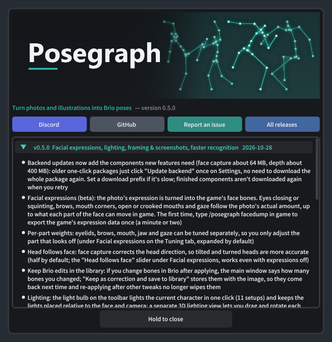

# Posegraph tutorial

**English** | [简体中文](README.zh-CN.md)

This tutorial takes you from installation to putting a photo's pose on your GPose character, then covers the image
library, extra views and posing several characters. The numbers in each screenshot match the notes on its right.
The UI screenshots are made with the [offline screenshot tool](../../tools/UiPreview); the sample photos are credited at the end.

**Results**: the tutorial's four sample photos recognized and put on an in-game character (Midlander male, with the photo's camera matched):

<table>
  <tr>
    <td></td>
    <td></td>
  </tr>
  <tr>
    <td align="center">Leaning on a wall</td>
    <td align="center">Arms open</td>
  </tr>
  <tr>
    <td></td>
    <td></td>
  </tr>
  <tr>
    <td align="center">Sitting on a ledge</td>
    <td align="center">Martial arts leap (two people in the photo; the whole image is treated as one person for now, and it picked the one in the air)</td>
  </tr>
</table>

## Contents

1. [Before you start](#1-before-you-start)
2. [Set up the backend](#2-set-up-the-backend)
3. [The main window](#3-the-main-window)
4. [Recognize your first image and apply it](#4-recognize-your-first-image-and-apply-it)
5. [3D tab: check and fine-tune joints](#5-3d-tab-check-and-fine-tune-joints)
6. [Tuning tab: amplitude and corrections](#6-tuning-tab-amplitude-and-corrections)
7. [Hints tab](#7-hints-tab)
8. [Image library](#8-image-library)
9. [Extra views: fixing front/back depth](#9-extra-views-fixing-frontback-depth)
10. [Several characters: the character list](#10-several-characters-the-character-list)
11. [Camera matching, export and restore](#11-camera-matching-export-and-restore)
12. [Facial expressions (beta)](#12-facial-expressions-beta)
13. [Keeping Brio edits in the library](#13-keeping-brio-edits-in-the-library)
14. [Lighting](#14-lighting)
15. [Framing and screenshots](#15-framing-and-screenshots)
16. [Video motion (beta)](#16-video-motion-beta)
17. [Updates](#17-updates)
18. [FAQ](#18-faq)

---

## 1. Before you start

You need:

- FFXIV with Dalamud and **[Brio](https://github.com/Etheirys/Brio)** enabled
- The **Posegraph backend package**: [Posegraph-Backend-win64.zip](https://drive.google.com/file/d/1PnbqdyH0hOTMSPhBaSXQ-Dpjp3fil6k2/view?usp=sharing) (about 4 GB).
  Unzip it somewhere with enough space, using an **English-only path** such as `D:\Posegraph-Backend`
- For GPU recognition, an NVIDIA card with about 3 GB of free VRAM; without one it runs on the CPU (about 10–20 s per image)

Install the plugin:

1. In game, type `/xlsettings` → **Experimental** → Custom Plugin Repositories, add
   `https://raw.githubusercontent.com/extrant/DalamudPlugins/main/pluginmaster.json`, tick it and save.
2. Search for **Posegraph** in the plugin installer and install it.
3. Type `/posegraph` to open the main window. The changelog pops up the first time; hold the "Hold to close" button to dismiss it.

## 2. Set up the backend

Go to the main window's **Settings** tab:

1. Click **Choose backend package folder…** and pick the folder you unzipped (it contains `python` and `backend`).
2. "Paths OK" and "Up to date" mean you're set.
3. Click the **power** button at the top right to start the backend. Tick "Start the backend when the plugin loads" so you don't have to every time.
4. Leave the device on **Auto**: it uses the GPU when there is enough VRAM and falls back to the CPU otherwise.

The status icons from left to right are Brio, GPose, IVCS (appears once a character is selected in GPose), backend,
VRAM and RAM. All green means you're ready. Hover over an icon for details.

## 3. The main window

The toolbar has three rows: status and the backend switch; tools (library, save to library, extra views, character list, lighting, composition and screenshots);
and the **character to pose**, the person in the image and the **race skeleton**. The race is detected from the
character's appearance, so you rarely need to change it.

## 4. Recognize your first image and apply it

1. Enter GPose and select the character to pose (or pick one from the dropdown in the third row).
2. Drop an image on the **Image** tab, or click the dashed area to pick one from the library. The first recognition loads
   the model (about 10–20 s); after that it takes a few seconds per image. Recognized images are cached and reopen instantly.
3. Check the overlay: **green** is the skeleton recognized from the photo, **orange** is the FF14 skeleton for your race.
   If they roughly line up, you're good.
4. Click **Apply** (▶) at the bottom left and the pose is on your character.

The result (this one also used "Match camera" below, so the camera matches the photo too):

Tips:

- For illustrations choose **Tuning → Preset → Illustration**; it tones down exaggerated head and neck proportions.
- Images dropped on the main window are not added to the library automatically; click "Save to library" in the second row if you want to keep them.

## 5. 3D tab: check and fine-tune joints

- Drag to rotate, scroll to zoom, drag with the right or middle button to pan, double-click to reset the view. Looking from the side reveals depth problems you can't see in the photo.
- **Click a joint** to select it: three rotation rings appear on it (red, green and blue, one per axis; drag a ring to rotate, like in Brio), and sliders for that joint (manual offsets) appear below.

- Yellow / red dots mark joints whose angles are outside the usual in-game range and may clip.
- When you're happy, click **Save correction** at the top left: the offsets and the Tuning tab's values are stored with this
  image and restored the next time you open it.

## 6. Tuning tab: amplitude and corrections

- **Amplitude**: 1 = as in the photo, below 1 calmer, above 1 stronger. Right-click a slider to reset it.
- **Hand contact compensation**: keeps hands on the head, chest or hips (your race's proportions differ from the person in the photo).
- **Stance**: gravity correction (straightens the body when the photo's camera is tilted), snapping to the ground, and "Flatten planted feet" (feet standing on the ground are laid flat like in game; only the foot turns, the legs stay).
  **Turn off snapping for jumps and mid-air poses.**
- **Helper bones**: how strongly the skin helpers at elbows, knees, shoulders etc. follow.
- **Whole-body rotation / offset**: when the whole person leans or needs raising or lowering (someone sitting on a chair), rotate around the hips or move everything; camera matching doesn't undo it.
- New images start from the defaults; keep this image's values with **Save correction** at the top, which also tells you about unsaved changes.

## 7. Hints tab

Lists joints outside the usual in-game range; red is more serious than yellow. The buttons below apply the suggested amplitude.
(The screenshot was made offline without a game character, which is why it also says the race could not be determined. You won't see that in game.)

## 8. Image library

The first button in the second toolbar row opens the library.

- **Import** images (multi-select), whole folders, the clipboard, or drop files on the library window. Duplicates are detected by content.
- **Add folder** adds an existing image folder as a source (nothing is copied).
- Organize with folders, tags (search `#tag`) and favorites; rename, move, or delete to the Recycle Bin.
- A green check means the image has been recognized; select several and right-click → Recognize to batch them.
- **Double-click** opens an image in the main window; **right-click** has extra views, save to the Brio pose library and more.

## 9. Extra views: fixing front/back depth

The hardest thing to tell from a single photo is depth: is the hand in front of the body or behind it, is the leg raised
forward or to the side? If you have **the same pose from another angle**, attach it as an extra view. The plugin fuses it
automatically and only corrects depth; **the pose you see in the main image stays the same**.

In the library, right-click the main image → **Extra views** (or use the extra views button in the main window's toolbar):

- **Add from files** / **Paste from the clipboard**, or attach other images selected in the library. Extra views don't show up in the library grid.
- Images named "main-1", "main-2" are attached to "main" automatically when imported.
- The menu shows the detected camera angle (left / right / back / almost the same angle) and warns when an image doesn't match the main pose.
- Untick "Use extra views" on the 3D tab to compare.

What makes a good extra view:

| Good | Not helpful |
|---|---|
| A **side view** at about 90° | A back view (same depth axis as the front) |
| Full body, the same pose | Less than 30° from the main image |
| Camera roughly at eye level | Images where an AI changed the pose (you'll get a "doesn't match" warning) |

When generating a side view with AI, ask for "exactly the same pose, the same hands and feet on each side, a 90° side view with the camera at chest height", then check that left and right weren't swapped.

## 10. Several characters: the character list

The "character list" button in the second toolbar row opens this window, docked to the right of the main window.
"Merge" at the top (splitting the people of one image across several characters) is still being polished; it's grayed out in this version and opens in the next one.

1. In GPose the list shows every character you can pose.
2. **Drag an image from the library onto the box** to the left of a character, one image per character.
3. Click **Apply all**: each image uses its own saved correction (or the defaults), and extra views are fused automatically.
4. To fine-tune one character, click **Edit**: the main window switches to that character and opens its image. Save the correction on the 3D tab when you're done.

Bindings only last for the current GPose session.

Three characters, one image each, after "Apply all":

## 11. Camera matching, export and restore

Buttons at the bottom of the main window:

- **Match camera** (camera icon): moves the GPose camera to the photo's position, distance and angle. Needs the Posegraph HTTP service (Settings, on by default).
- **Restore** (↶): goes back to the pose before the first apply.
- **Export** (disk icon): export a `.pose` file, or save to the Brio pose library (with preview and tags, ready in Brio's library).

After matching, the status line shows the camera position and framing error (0.4 cm and 6.2% here):

## 12. Facial expressions (beta)

Turns the expression in the photo into the game's face bones: eyes closing or squinting, brows, mouth corners, open or crooked
mouths and gaze follow the photo's actual amount, up to what each part of the face can move in game, so nothing gets distorted.

1. **The first time**, type `/posegraph facedump` in game (or click "Export game expression data" in the facial expression section)
   to export the game's own expression animations once (a minute or two).
2. On the Tuning tab open **Facial expression (test)**, tick **Apply to character**, then apply.
3. **Per-part weights (recommended)**: eyelids, brows, mouth, jaw and gaze can be tuned separately. Adjust just the part that looks off,
   which works better than the overall "Strength": e.g. raise "Jaw" if the mouth doesn't open enough, lower "Gaze" if the eyes wander. Right-click a slider to reset it to 1.
4. **Head follows face**: face capture corrects the head direction, so tilted and turned heads are more accurate. 0.5 by default (half each);
   0 uses only the whole-body recognition, 1 follows the face fully. This works even with expressions off, and shows how far the face and the recognized head differ.

Not possible yet: sticking out the tongue (the game's animations never move it, and face capture can't measure it); a one-eyed wink and a
squinting smile are sometimes confused. Face capture rarely finds faces in illustrations and then simply isn't used.

## 13. Keeping Brio edits in the library

If you rotate bones in Brio after applying a pose, the main window shows "Detected N bones changed in Brio" under the toolbar:

- **Keep as correction and save to library** turns the edits into joint offsets on the 3D tab (the same thing as dragging bones there)
  and saves them in this image's correction. They come back the next time you open the image, re-applying after changing Tuning values
  no longer wipes them, and you can keep fine-tuning them on the 3D tab.
- **Ignore** takes the current pose as the new baseline; you'll be told again only after further edits.

Only body bone rotations are kept. Face bones and bone positions or scale are not; helper bones such as shoulders and elbows follow their
main bones automatically, so edits to helper bones alone can't be kept either.

## 14. Lighting

The light bulb button in the second toolbar row. Click a setup to light the current character (loop, Rembrandt, butterfly, split,
backlight and more, 11 in total). Lights are placed relative to the character and the camera. With "Follow camera" on they turn with the camera;
with "Follow character" on they are placed again when Posegraph changes the character's pose or the character is moved or turned.

- **Match the photo**: estimates where the key light comes from, how hard it is, how warm or cool, and the light ratio from the shading on the
  face in the main window's photo, and places the lights to match. Without a face it uses the bare skin on the body, and with little bare skin it
  forces a rough estimate from the shading on the clothes. The first click per photo takes a few seconds.
- **Photo colors**: keeps the lights where they are and only recolors them from the photo; if the photo's background isn't dark, a background
  light aimed behind the character is added. The swatches below show the colors picked from the photo.
- **Light area**: face / half body / full body. "Auto" (the default) follows how much the game camera shows - feet visible is full body,
  waist visible is half body, otherwise the face. For larger areas the lights move further away and widen so the whole character is lit.
- The sliders adjust overall brightness, warmth, light distance and fill (lower fill gives a higher light ratio; turn it down when the scene
  itself is already bright).
- **Save to this image**: stores the current lights with the main window's image; they are restored whenever that image's pose is applied
  ("Restore with pose").
- **3D lighting**: a separate window docked to the right of the lighting window; show or hide it with "3D lighting" and drag to resize its width.
  It shows every light, the character and the camera: drag a light to move it, drag the diamond to turn the light head; switch between camera view,
  front, side and top. The ball at the top right previews the lighting ratio.
- The buttons below the 3D view select a light; "Adjust each light" lets you solo or mute a light, change its color, intensity and angle,
  and add an effect (flicker, pulse, orbit, color cycle).
- Status messages appear in the lighting window's title bar. Lights are removed automatically when you leave GPose.

## 15. Framing and screenshots

The crop button in the second toolbar row.

- **Show framing guide** draws a frame of the chosen aspect ratio over the game, dims the outside and can add guides such as the rule of thirds; switch between landscape and portrait.
- **Fit to photo** takes the ratio and orientation from the photo. "Photo reference" overlays the photo inside the frame so you can line up the camera; you can also overlay the skeleton recognized from it.
- In GPose it shows and sets the **equivalent full-frame focal length** (the 35 mm, 85 mm photographers talk about).
- **Screenshot** captures the game's own render inside the frame, saved to Documents\Posegraph\Screenshots by default; the button next to it opens the folder.

## 16. Video motion (beta)

Recognize the motion in a video frame by frame and play it in GPose like an animation, then correct it or record it to video. The film button in the second toolbar row opens the video window.

**Recognize**

1. "Open video…" (mp4 / mov / webm / mkv / avi). The first 10 seconds are selected by default: scrub to where you want and click "Set start" / "Set end".
2. Scrub to a frame where the person is clear, click "Find people" and click the person in the frame. For couple dances, hugs or sparring you can **pick several**: the first one is the lead, then choose a game character for each.
3. Pick the "Frame rate": 5 / 10 fps is enough for slow motion, use 15 / 30 for fast dancing. "Smoothing" removes frame-to-frame jitter; too much makes fast moves sluggish.
   Tick "Expression" to capture the face frame by frame (more conservative than for photos).
4. "Recognize". The backend works through the frames (about half a second per frame on GPU, so a one-minute video at 10 fps takes about 5 minutes). You can close the window; the clip is saved and loaded when it's done.
   Clips are saved in Documents\Posegraph\Clips; open them again with "Open clip…".

**Play**

- Enter GPose, choose the character and press play. "Music" plays the video's music (or an audio file with the same name in the same folder) in sync.
- **Follow**: the character stays in place and the camera moves with the video's framing every frame - handheld and tracking shots look closest to the original.
- **Walk**: the character moves through the scene like in the video, feet planted. "Shot" offers Original camera, Fixed camera, Smooth follow or Fixed-point pan;
  "When the actor is off screen" can replace the parts where the original camera looks away with an automatic camera.
- **Camera adjustments**: dolly, zoom, shift, orbit, tilt and roll; the "Tracking point" sets whether the automatic camera aims at the head, chest, hips or whole body; "Keep whole body in frame" keeps raised hands and kicks in frame.
  Saved per clip.
- When the playing character's race or body changes (Glamourer), the clip is rebuilt for the new skeleton automatically, without recognizing again.
- "Save current frame to Brio pose library" saves the frame on screen as a Brio pose.

**Timeline corrections**

Fix what recognition got wrong (fingers especially) by hand; corrections are saved in the clip and kept when rebuilding for another race and when recording. Open "Timeline corrections" below the player:

1. Pause on the frame to fix and move bones directly in **Brio**.
2. The panel says "The pose at x s was changed in Brio"; click **Keep as correction** and that frame becomes a keyframe (a diamond on the track). "Revert" discards the change.
3. Select a keyframe to change its "Range": **Ease in and out** (over the transition time on each side: fully corrected close to the keyframe, then blending back to the original motion)
   or **Hold to next** (held until the next keyframe of these bones). You can also remove the correction on a single bone.
4. **Copy correction** copies the selected keyframe's change, which follows the original motion wherever you paste it; **Copy pose** copies how a bone group looks on the current frame
   (left hand, right hand, both hands, arms, head and neck, whole body) and pastes it as is - use this when you need the same hand gesture many times.
5. **Paste to current frame**, or mark a range with "In" and "Out" and **Paste to range**: held across the range, fading out after the out point.
6. On the track, click empty space to jump to that frame, drag a diamond to move it, right-click a diamond to copy or delete it; undo if you change your mind.

Each change only rebuilds the affected frames (a few dozen frames take a second or two). The first correction after opening an older clip rebuilds the whole clip once to read the character's current bone lengths.
Face bones and helper bones such as shoulders and elbows can't be kept (helper bones follow the main bones automatically).

**Record to video**

"Record video" poses each frame and captures the game screen, saved to Documents\Posegraph\Videos, optionally with the video's music. Don't move the camera or windows while recording.

Current limits: fingers come straight from the recognition model and are often wrong for small or blurry hands - fix them with timeline corrections; for videos with cuts, select one continuous shot;
when the person is small in the frame (wide shots), motion and expressions get worse.

## 17. Updates

- **Plugin**: updates automatically through the plugin repository. The changelog pops up the first time you open the main window after an update.
- **Backend**: after a plugin update the Settings tab shows the backend version. When it's older, click the download button next to it:
  it downloads the matching backend code and **adds whichever components new features need (face capture about 64 MB, depth about 400 MB)**,
  verifying each download, so you never need the whole package again. The backend is stopped first and restarted afterwards; if the new
  version doesn't start, the old one is restored. If GitHub is unreachable or slow, fill in a download mirror prefix; if a download breaks,
  just click again — finished components aren't downloaded twice.
- **Downloads fail in the plugin**: download the files from GitHub in a browser or get the archives from a friend and unpack them into the package yourself; see [Updating the backend by hand](../manual-update.md).

## 18. FAQ

**Recognition is slow / not enough VRAM**
Keep the device on Auto; with less than 3 GB of VRAM it uses the CPU automatically. CPU recognition takes about 10–20 s
per image, and recognized images are cached. Setting "Unload model" to "Keep loaded" saves the loading time but keeps the VRAM or RAM in use.
"Fast recognition" is on by default (about 0.6 s for one person). "Depth-assisted recognition" makes the focal length and floor more accurate
but adds about 0.5 s per image and about 1.3 GB of peak VRAM; turn it off if your machine is tight.

**The backend closes right after starting, and the log says "Cannot create thread" or "System error #1455"**
Windows has run out of memory including virtual memory (the game alone takes over 10 GB). Enlarge the page file or set it to
system-managed, or restart the game and close programs you don't need before recognizing.

**Hands go into the body / don't reach the head**
"Hand contact compensation" on the Tuning tab keeps contact; try a larger "Full effect" distance. Otherwise select the joint on the 3D tab and adjust it by hand.

**A leg or arm points the wrong way front/back**
That's the depth ambiguity of a single photo. A side view as an extra view fixes it best; you can also adjust it on the 3D tab.

**A jump gets pushed to the ground**
Tuning → Stance → turn off "Snap to ground".

**Wrong race**
Pick it manually in the race dropdown at the right of the third toolbar row (happens with race-changing mods or Customize+).

**Fingers are off**
Fingers are more accurate with the IVCS skeleton. Without it the IVCS icon is yellow and the third finger joint's bend is folded into the second.

More questions? Ask on [Discord](https://discord.gg/2z6KdPgacj) or open a [GitHub issue](https://github.com/extrant/Posegraph/issues).

---

### Sample image credits

The sample photos are CC0 (public domain) from Wikimedia Commons, downscaled:

| File | Original |
|---|---|
| `images/sample-lean-wall.jpg` | [Arkansas woman poses (Unsplash)](https://commons.wikimedia.org/wiki/File:Arkansas_woman_poses_(Unsplash).jpg) |
| `images/sample-sit-wall.jpg` | [Smile in Air (Unsplash)](https://commons.wikimedia.org/wiki/File:Smile_in_Air_(Unsplash).jpg) |
| `images/sample-arms-open.jpg` | [Woman posing by drainpipe (Unsplash)](https://commons.wikimedia.org/wiki/File:Woman_posing_by_drainpipe_(Unsplash).jpg) |
| `images/sample-kalaripayattu.jpg` | [Kalaripayattu mock combat in rural Kerala](https://commons.wikimedia.org/wiki/File:Kalaripayattu_mock_combat_in_rural_Kerala.jpg) |
