# Posegraph 使用教程

[English](README.md) | **简体中文**

这份教程带你从安装到把一张照片的姿势摆到 GPose 角色身上，再介绍图库、辅助视角、多角色、面部表情、灯光、构图截图、视频动作，以及在游戏里直接拖控制点摆姿势（姿势编辑器、手部吸附）这些进阶功能。
截图里的数字对应右侧的说明。界面截图由 [离线截图工具](../../tools/UiPreview) 生成，示例照片的来源见文末。

**效果展示**：教程里的四张示例照片识别后摆到游戏角色身上（人族中原男，复刻了照片镜头）：

<table>
  <tr>
    <td></td>
    <td></td>
  </tr>
  <tr>
    <td align="center">倚墙</td>
    <td align="center">张开双臂</td>
  </tr>
  <tr>
    <td></td>
    <td></td>
  </tr>
  <tr>
    <td align="center">坐在高台上</td>
    <td align="center">武术腾空（图里有两个人；目前整张图按一个人识别，这里识别到的是腾空的那位）</td>
  </tr>
</table>

## 目录

1. [准备工作](#1-准备工作)
2. [第一次设置后端](#2-第一次设置后端)
3. [认识主窗口](#3-认识主窗口)
4. [识别第一张图并应用](#4-识别第一张图并应用)
5. [3D 页：检查和微调关节](#5-3d-页检查和微调关节)
6. [调整页：幅度与修正](#6-调整页幅度与修正)
7. [提示页](#7-提示页)
8. [图库](#8-图库)
9. [辅助视角：修正前后深度](#9-辅助视角修正前后深度)
10. [多个角色：角色列表](#10-多个角色角色列表)
11. [复刻镜头、导出与还原](#11-复刻镜头导出与还原)
12. [面部表情（测试）](#12-面部表情测试)
13. [Brio 里改过的姿势收进图库](#13-brio-里改过的姿势收进图库)
14. [灯光](#14-灯光)
15. [构图与截图](#15-构图与截图)
16. [视频动作（测试）](#16-视频动作测试)
17. [转换为 idle（待机动作）](#17-转换为-idle待机动作)
18. [在游戏里编辑（姿势编辑器）](#18-在游戏里编辑姿势编辑器)
19. [手部吸附与「贴到部位」（实验）](#19-手部吸附与贴到部位实验)
20. [更新](#20-更新)
21. [常见问题](#21-常见问题)
22. [交流与赞助](#22-交流与赞助)

---

## 1. 准备工作

你需要：

- 装好 Dalamud 并启用 **[Brio](https://github.com/Etheirys/Brio)** 的 FF14
- **Posegraph 后端**：下载 [Posegraph-Installer.zip](https://github.com/extrant/Posegraph/releases/download/backend-components-1/Posegraph-Installer.zip)，解压后双击 `Install-Posegraph.bat`，
  按提示选安装位置（**路径只用英文**，比如 `D:\Posegraph-Backend`）、计算方式和网络方式，等它装完（约 3~6GB）。
  国内网络选「中国网络」；显卡会自动识别并推荐计算方式。详见 [安装脚本说明](../../installer/README.md)
- 用显卡识别要 NVIDIA 显卡或支持 ROCm 的 AMD 显卡（RX 9000 系、RX 7900 / 7800 / 7700 等）、可用显存约 3GB；没有也能用 CPU（每张约 10~20 秒）

安装插件：

1. 游戏里输入 `/xlsettings` → **实验性** → 自定义插件仓库，添加
   `https://raw.githubusercontent.com/extrant/DalamudPlugins/main/pluginmaster.json`，勾选并保存。
2. 插件管理器里搜索 **Posegraph** 并安装。
3. 输入 `/posegraph` 打开主窗口。第一次打开会弹出更新日志，按住「按住关闭」按钮即可关掉。

## 2. 第一次设置后端

切到主窗口的 **设置** 页：

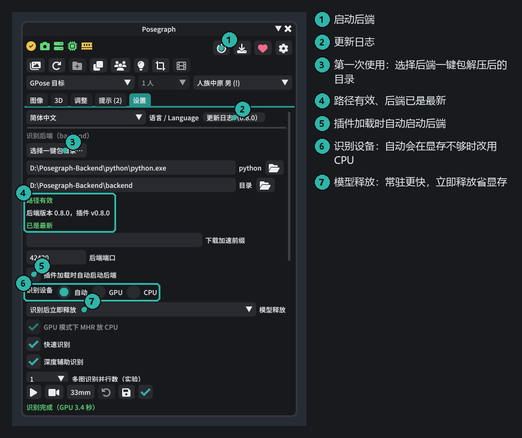

1. 点 **选择一键包目录…**，选安装脚本装好的文件夹（里面有 `python` 和 `backend`）。装的时候游戏没开的话，脚本已经自动填好了。
2. 下方显示「路径有效」「已是最新」就对了。
3. 点右上角的 **电源** 按钮启动后端；勾上「插件加载时自动启动后端」以后就不用每次点。
4. 识别设备保持 **自动** 即可：显存够就用显卡，不够自动改用 CPU。

状态栏的图标从左到右是 Brio、GPose、IVCS（在 GPose 里选中角色后才出现）、后端、显存、内存，全绿就可以开始了。鼠标停在图标上能看到详情。

## 3. 认识主窗口

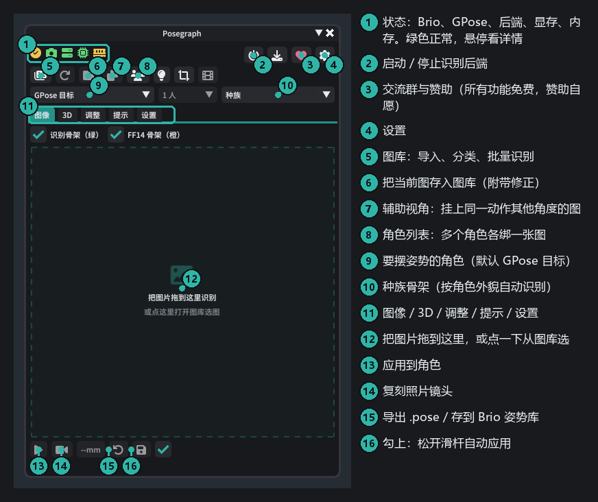

工具栏分三行：第一行是状态、后端开关和右上角的爱心（交流群与赞助，见[第 22 节](#22-交流与赞助)），第二行是工具（图库、存入图库、辅助视角、角色列表、灯光、构图与截图），
第三行选 **要摆姿势的角色**、图里的人物和 **种族骨架**。种族默认按角色外貌自动识别，一般不用改。

## 4. 识别第一张图并应用

1. 进入 GPose，选中要摆姿势的角色（或在第三行的下拉框里选）。
2. 把图片拖到 **图像** 页，或者点那块虚线区域从图库里选。第一次识别要加载模型（约 10~20 秒），之后每张几秒；
   识别过的图会缓存，再打开不用等。
3. 看叠加层：**绿线**是从照片识别出的骨架，**橙线**是换算到你种族后的 FF14 骨架。两条线大致重合就说明没问题。
4. 点左下角的 **应用**（▶），姿势就摆到角色身上了。

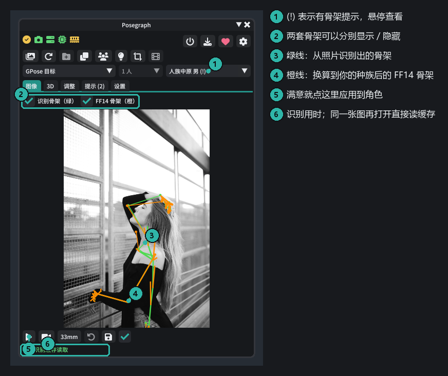

应用后的效果（这张还用了下面的「复刻镜头」，镜头也和照片一致）：

小技巧：

- 插画选 **调整 → 预设 → 插画**，会收敛插画里夸张的头颈比例。
- 拖进主窗口的图不会自动存进图库；觉得好用就点第二行的「存入图库」按钮。

## 5. 3D 页：检查和微调关节

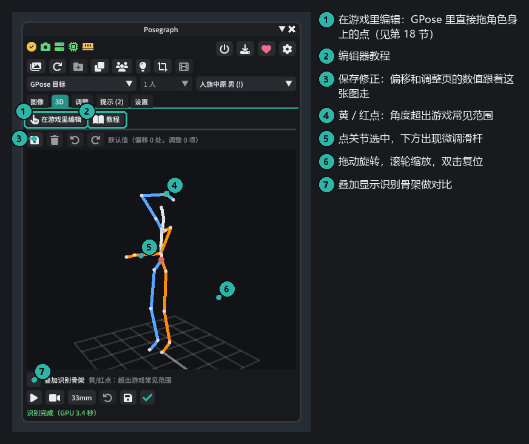

- 拖动旋转，滚轮缩放，右键或中键拖动平移，双击复位视角。从侧面看能发现照片里看不出来的前后深度问题。
- **点一个关节**选中它，关节上会出现三个旋转环（红、绿、蓝各管一个轴，和 Brio 一样拖环就转），下方也有这个关节的微调滑杆（手动偏移）。

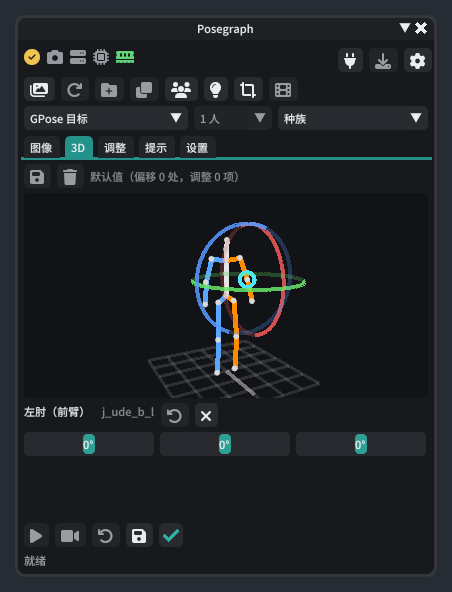

- 黄色 / 红色的点表示这个关节的角度超出游戏动画的常见范围，可能会穿模。
- 调好后点左上角的 **保存修正**：偏移和调整页的数值都存进这张图，下次打开自动恢复。
- 页面顶部的 **在游戏里编辑** 可以在 GPose 里直接拖角色身上的点摆姿势，**教程** 是它的图文说明，见[第 18 节](#18-在游戏里编辑姿势编辑器)。

## 6. 调整页：幅度与修正

- **幅度**：1 = 照片原样，小于 1 动作收敛，大于 1 更夸张。滑杆上点右键恢复默认。
- **手部末端补偿**：手贴着头、胸、髋时保持接触（不同种族的身材比例和照片里的人不一样）。
- **站姿**：重力校正（照片相机歪了时把人扶正）、自动贴地，以及「踩地的脚放平」（踩在地上的脚放成游戏里平放的样子，只转脚不动腿）。**跳跃、腾空的图请关掉自动贴地。**
- **辅助骨**：肘、膝、肩等处的蒙皮联动强度。
- **整体旋转 / 位移**：整个人歪了、要抬高放低（坐在椅子上的人）时用，绕髋部转或整体挪动；复刻镜头会跟着人转、跟着人挪，画面里的构图仍和照片一致。
- 新图片都从默认值开始；这张图调好的值用顶部的 **保存修正** 存下来。顶部会提示有没有未保存的修改。

## 7. 提示页

列出超出游戏常见范围的关节，红色比黄色严重。下面的按钮可以一键按建议调整幅度。
（截图是离线生成的，没有读到游戏里的角色，所以多了一条「无法确定种族」。在游戏里不会出现。）

## 8. 图库

点工具栏第二行第一个按钮打开图库。

- **导入**：多选图片、整个文件夹、剪切板粘贴，或者直接把文件拖进图库窗口。按图片内容查重，不会重复复制。
- **添加文件夹**：把电脑上已有的图片文件夹加为来源（不复制）。
- 用文件夹、标签（搜索 `#标签`）、收藏来分类；可以重命名、移动、删除到回收站。
- 右上角绿色对勾表示已经识别过；选中多张右键「识别」可以批量识别。
- **排序**：缩略图大小左边的下拉框，可按名称、改动时间（图片改过，或在 Posegraph 里存了修正、灯光，取最晚的）、添加时间排，旁边的按钮切正序 / 倒序。
- **双击**打开到主窗口；**右键**还有辅助视角、存到 Brio 姿势库等。

## 9. 辅助视角：修正前后深度

单张照片最难判断的是前后深度，比如手是在身前还是身后、腿往前抬还是往侧抬。
如果有**同一个动作从别的角度拍的图**，可以挂上去作为辅助视角，插件会自动融合，只修正深度，
**不会改动主图里看到的姿势**。

在图库里右键主图 → **辅助视角**（主窗口工具栏的辅助视角按钮也行）：

- **从文件添加** / **粘贴剪切板里的图片**，也可以把图库里同时选中的其他图挂上来。辅助图不会出现在图库网格里。
- 文件名为「主图名-1」「主图名-2」的图，导入图库时会自动挂到主图上。
- 菜单里会显示自动判断的机位（左侧 / 右侧 / 背面 / 几乎同角度），和主图动作对不上时会提示。
- 3D 页可以勾掉「使用辅助视角」对比效果。

怎样的辅助图效果最好：

| 推荐 | 不推荐 |
|---|---|
| 约 90° 的**正侧面** | 背面（和正面看到的深度一样，补不了） |
| 全身入画、同一个动作 | 和主图角度相差不到 30° 的图 |
| 机位大致平视 | 动作被 AI 改过的图（会提示「动作对不上」） |

用 AI 生成侧视图时，提示词里写明「严格保持同一姿势、同一侧的手脚、相机在胸口高度的 90° 正侧面」，生成后检查左右手有没有对调。

## 10. 多个角色：角色列表

主窗口第二行的「角色列表」按钮打开这个窗口，默认贴在主窗口右边。
窗口顶部的「合并」（一张图里的多个人分给各个角色）还在打磨，这一版是灰的，下个版本开放。

1. 进入 GPose，列表里会列出所有可以摆姿势的角色。
2. 从图库把图**拖到角色左边的格子**里，每个角色绑一张图。
3. 点 **全部应用**：每张图用它自己保存的修正（没有就用默认值），挂了辅助视角的自动融合。
4. 某个角色要细调：点 **编辑**，主窗口会切到这个角色并打开它的图；调好后在 3D 页保存修正。

绑定只在这次 GPose 里有效。

三个角色各绑一张图，点「全部应用」后的效果：

## 11. 复刻镜头、导出与还原

主窗口底部的按钮：

- **复刻镜头**（摄像机图标）：把 GPose 相机摆到照片的机位、距离和视角。需要 Posegraph HTTP 服务（设置页，默认开启）。点了会弹出三个选项：
  - **普通**：按照片原样复刻。
  - **顺旋 / 逆旋**：拍竖图用。游戏照常横屏渲染，镜头侧倒 90°（ReShade 的 SSAO、景深不会像竖屏模式那样出问题），竖照片的宽对着游戏画面的高，人占满画面。
    顺旋时游戏里人头朝左，逆旋时朝右；构图框和原图参考跟着躺下来，截图自动转回正的。构图窗口里会提示当前是哪种，可以改回普通。
- **照片焦距**（复刻镜头旁边「25mm」这类按钮）：识别用的等效焦距，复刻镜头的视角和远近都按它来。
  照片带 EXIF 焦距时直接用，否则由深度模型从画面估；贴脸特写、白底棚拍这类图常被猜成广角，长焦人像也猜不出来。
  人物看着变形、复刻出来的镜头太广角时点开选 24 / 35 / 50 / 85 / 135mm 或填一个，会按这个焦距重新识别，结果存进识别缓存，下次打开还是它；选「自动」改回来。
- **还原**（↶）：回到第一次应用前的姿势。
- **导出**（磁盘图标）：导出 `.pose` 文件，或存到 Brio 姿势库（带预览图和标签，在 Brio 资料库里直接能用）。

复刻镜头后，状态栏会显示机位误差和构图偏差（这张是 0.4cm、6.2%）：

## 12. 面部表情（测试）

把照片里的表情换算成游戏的脸部骨骼：闭眼、眯眼、挑眉、嘴角、张嘴、歪嘴、视线都按照片的实际幅度还原，最多到游戏里这块脸能动的极限，不会扭曲。

1. **第一次用**：在游戏里输入 `/posegraph facedump`（或点面部表情区里的「导出游戏表情数据」），导出一次游戏自带的表情动画（一两分钟，之后不用再导）。
2. 调整页展开 **面部表情（测试）**，勾上 **套用到角色**，再点应用。
3. **分项权重（推荐）**：眼睑、眉毛、嘴部、下巴、视线可以分开调。哪一块不像就单独调哪一块，比拖整体的「强度」好用：
   比如嘴张得不够就把「下巴」调大，眼神太飘就把「视线」调小。滑杆上点右键恢复 1。
4. **头部跟脸**：用面捕修正头的朝向，低头、侧脸的角度更准。默认 0.5（两边各取一半），0 只用整身识别的头，1 完全按脸。
   这一项不开表情也生效；下面会显示脸和整身识别的头差了多少度。

目前做不到：吐舌头（游戏动画里舌头从来不动，面捕也测不到）；单眨一只眼和笑眯眼有时分不清。插画的脸面捕多半找不到，会自动不用。

## 13. Brio 里改过的姿势收进图库

应用姿势后在 Brio 里手动转了骨骼，主窗口工具栏下面会出现「检测到在 Brio 里改了 N 根骨骼」：

- **收进修正并存进图库**：把这些改动换成 3D 页的关节偏移（和在 3D 页拖骨骼是一回事），存进这张图的修正。
  下次打开这张图自动套上；之后再改调整页的数值、重新应用，Brio 里的改动也不会被冲掉。在 3D 页还能接着微调。
- **忽略**：以现在的姿势为准，之后再改才会提示。

用「在游戏里编辑」（[第 18 节](#18-在游戏里编辑姿势编辑器)）改的姿势，点「完成」就直接存进修正，不用再点这个提示条。

只收身体骨骼的朝向。脸部骨骼、骨骼的位置和缩放收不进来；肩、肘这类辅助骨会跟着主骨自动联动，单独改辅助骨也收不进来。

## 14. 灯光

工具栏第二行的灯泡按钮。点一个方案就给当前角色打好光（环形光、伦勃朗光、蝴蝶光、分割光、逆光等 11 套），灯按相对人物和镜头的方位摆。
勾上「跟随镜头」后转镜头灯也跟着转；勾上「跟随角色」后，Posegraph 给角色换了姿势、或角色被挪动 / 转身，灯也跟着重新摆。

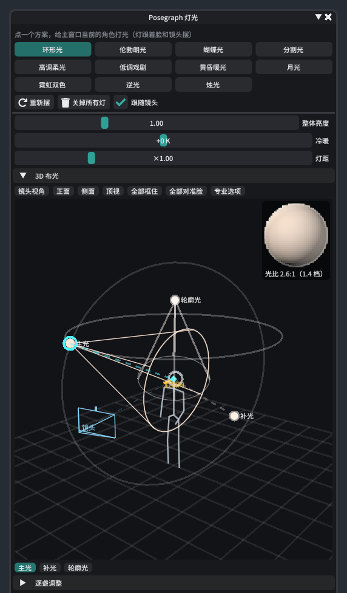

- **照片同款**：按主窗口照片里人物脸上的明暗，估出主光从哪来、软硬、冷暖和光比，照着摆灯。没有脸时看身上露出的皮肤，
  皮肤也少时按衣服的明暗强制估（只当个大概）。每张照片第一次点要算几秒。
- **照片配色**：灯的位置不动，只按照片换颜色；照片背景不暗时再加一盏照向身后的背景光。下面的色块是照片里取到的颜色。
- **打光范围**：脸 / 半身 / 全身。默认「自动」，看游戏镜头拍到多少——拍到脚是全身，拍到腰是半身，否则照脸。
  范围大时灯离远一些、光斑放宽，整个人都照得到。
- **照谁**：单人（只照主窗口选的角色）；一组（勾选的人当成一组，一套灯罩住所有人，光线统一）；
  每人一套（每个人身上各摆一套，人散得再开都照得到）；自动（约 2.5 米内的人合用一套，远的另起一套）。
  下面勾选要照的角色，默认全选，主窗口选的角色总是照。人多灯多时，离镜头远的几组会先不打（窗口里会提示）。
- **单独调某一套**：有几套灯时，在「调哪一套」里选（3D 布光窗口顶上和「逐盏调整」上面都有），或在 3D 布光里点那一套的灯，
  就只改这一套；「恢复成和其他套一样」撤回单独的改动。
- 滑杆整体调亮度、冷暖、灯的远近和补光（补光调小光比更大；场景本身已经很亮时调小）。
- **存进这张图**：把现在的灯存进主窗口当前的图，以后给角色套这张图的姿势时一并恢复（「套姿势时恢复」开关）。
- **3D 布光**：贴在灯光窗口右边的独立窗口，点「3D 布光」展开 / 收起，宽度可以拖。能看到每盏灯和角色、镜头的位置：
  拖灯移动，拖菱形点转灯头；可以切镜头视角、正面、侧面、顶视。右上角的小球是按现在的灯算的光比预览。
- 3D 布光窗口下面的按钮选中某一盏灯；「逐盏调整」里可以单独看（只开这一盏）或关掉某一盏，调颜色、强度、角度，
  「动态」可以加闪烁、呼吸、环绕、变色。
- **添加灯**：「逐盏调整」和 3D 布光窗口里都有，选主光、补光、轮廓光、头发光、侧光、顶光、底光、眼神光、背景光、环境光、彩色点缀，
  加好再逐盏调；还没打光时也能从空白开始一盏盏加，灯名右边的垃圾桶删掉。多人时灯加到「调哪一套」选中的那一套（「所有套一起调」就每套都加）。
- **恢复默认**：整体滑杆上面有「恢复默认」，右键某个滑杆单独恢复；每盏灯右边的按钮恢复成方案里的样子（改过的灯名后面带 *）；
  「整套恢复原样」回到刚套方案时。从空白开始加的灯没有原样，先「存成我的方案」，之后恢复就回到存的那一份。
- **撤销 / 重做**：灯光窗口和 3D 布光共用一份记录，Ctrl+Z / Ctrl+Y，或点「重新摆」左边的两个箭头。
- 操作结果显示在灯光窗口的标题栏。退出 GPose 时灯会自动清掉。

## 15. 构图与截图

工具栏第二行的裁切按钮。

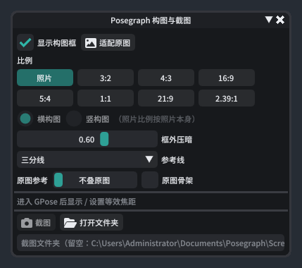

- **显示构图框**：按选的比例在游戏画面上画出取景框，框外压暗，可以加三分线等参考线；横构图、竖构图可以切换。
- **适配原图**：比例和横竖都按照片来；照片比例下也可以强制横构图或竖构图（比例倒过来用，照片会被裁掉一部分）。「原图参考」可以把照片半透明叠在框里，对着摆镜头；也可以叠上照片识别出的骨架。
- 进入 GPose 后会显示和设置**等效全画幅焦距**（摄影里说的 35mm、85mm）。
- **截图**：按框截一张游戏内渲染的原图，默认存到 文档\Posegraph\Screenshots，旁边的按钮直接打开文件夹。
- 复刻镜头选了顺旋 / 逆旋（见第 11 节）时，构图框和原图参考是躺着的，截图自动转回正的；窗口里有提示，「改回普通」只改框和截图。

## 16. 视频动作（测试）

把一段视频里的动作逐帧识别出来，在 GPose 里像动画一样播放，可以修正。工具栏第二行的胶片按钮打开视频窗口。

**识别**

1. 「打开视频…」（mp4 / mov / webm / mkv / avi）。默认截取前 10 秒：拖动滑条到想要的位置，点「设为起点」「设为终点」。
2. 拖到人物清楚的一帧点「找人」，在画面上点选要识别的人。双人舞、拥抱、对练可以**多选**：先点的是主角，再给每个人选一个游戏角色。
3. 选「帧率」：慢动作 5 / 10 帧每秒就够，快的舞蹈用 15 / 30。「平滑」压掉逐帧的抖动，太大快动作会变钝。
   「表情」勾上会逐帧识别脸上的表情（视频里比照片保守）。
4. 「开始识别」。后端逐帧识别（GPU 大约每帧半秒，一分钟的视频按 10 帧每秒约 5 分钟），可以关掉窗口，完成后自动存成片段并载入。
   片段存在 文档\Posegraph\Clips，以后用「打开片段…」再打开。

**播放**

- 进 GPose，选好角色，点播放。下面的「放音乐」会同步放原视频的音乐（或同一文件夹里同名的音频文件）。
- **跟拍**：角色原地不动，镜头每帧按原视频的构图移动，手持、跟拍的视频最像原片。
- **走动**：角色按视频在场景里走，脚踩着地不打滑。「机位」可选原运镜、固定机位、平滑跟拍、定点摇镜；
  「拍不到人时」可以把原视频镜头移开的几段换成自动镜头。
- **镜头调整**：推近、变焦、平移、环绕、俯仰、侧倾；「跟踪点」决定自动镜头对准头、胸、腰还是全身；「全身入画」让举手踢腿时手脚不出画。
  每个片段各存一份。
- 播放的角色换了种族或体型（Glamourer 改了），会自动按新骨架重算，不用重新识别。
- 「存当前帧到 Brio 姿势库」把正在显示的这一帧存成 Brio 姿势。

**时间轴修正**

识别不准的地方（尤其是手指）可以手动修，修正存在片段里，换种族重算时也带着。展开播放器下面的「时间轴修正」：

1. 暂停到要修的那一帧，直接在 **Brio** 里拖骨骼。
2. 这里会提示「Brio 里改了第 x 秒的姿势」，点 **收进修正**，这一帧就成了一个关键帧（轨道上的菱形）；点「还原」放弃改动。
3. 选中关键帧可以改「影响」：**渐入渐出**（前后「过渡」秒内，离关键帧近的一段完全按修正，再慢慢退回原动作）
   或 **保持到下一个**（一直保持到这些骨骼的下一个关键帧）。也能单独去掉某根骨骼的修正。
4. **复制修正** 复制选中关键帧的改动量，贴到别处时跟着那里原本的动作走；**复制姿势** 复制当前帧一组骨骼的样子
   （左手、右手、双手、手臂、头颈、全身），贴到别处原样贴上——同一个手势要用很多次时用这个。
5. **粘贴到当前帧**；或者用「入点」「出点」框一段，**粘贴到区间**：整段保持，出点后渐出。
6. 轨道上点空白处跳到那一帧，拖菱形改时间，右键菱形复制、删除；改错了点撤销（Ctrl+Z），撤多了点重做（Ctrl+Y）。

每次修改只重算受影响的那几帧（几十帧一两秒）。打开旧片段后的第一次修正会先整段重算一次，读取角色现在的骨长。
脸部骨骼和肩、肘这类辅助骨收不进来（辅助骨会跟着主骨自动联动）。

目前的限制：手指用识别模型自带的结果，小手、模糊的手常不准，请用时间轴修正手动调；有切镜的视频建议截取一段连续镜头；
视频里人太小（远景）时动作和表情都会变差。

## 17. 转换为 idle（待机动作）

把图库里一张图的姿势做成角色站着、坐着或打盹时循环播放的待机动作，存成 Penumbra 模组（需要装 Penumbra）。
用的是这张图保存的修正，所以先在 3D 页 / 调整页调好再转。

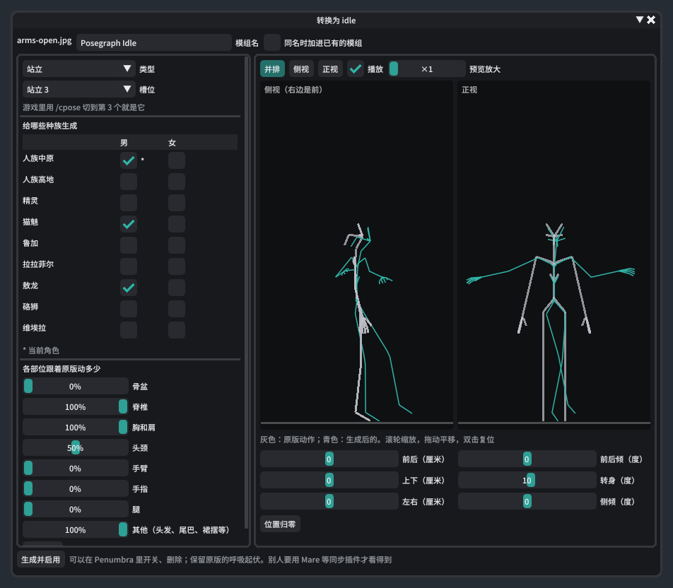

1. 图库里右键这张图，选 **转换为 idle…**。
2. 选 **类型**（站立 / 坐椅子 / 坐地上 / 打盹）和 **槽位**：「默认」是不切 `/cpose` 时用的那个，数字就是 `/cpose` 切到的第几个。
3. 勾选 **给哪些种族生成**（男女分开），当前角色的种族带 *。有的种族某个槽位用的是别的种族的动画，窗口会提示「会一起改到」哪个种族。
4. 点 **预览位置**：右边的侧视 / 正视会循环播放，灰色是原版动作，青色是生成后的。滚轮缩放、拖动平移、双击复位；「预览放大」只放大预览里的动作幅度，方便看清呼吸。
5. 需要的话调位置：**前后 / 上下 / 左右**（厘米）挪动身体，**前后倾 / 转身 / 侧倾**（度）绕骨盆转。坐、躺默认把骨盆放在原版动作的位置（坐得上椅子），站立的会自动踩到地上。
6. **各部位跟着原版动多少**：0% 保持姿势不动，100% 和原版一样。默认只让躯干呼吸，手臂、腿、骨盆不动（原版的摆手、换重心叠到别的姿势上会显得乱，脚也会滑）。
7. 填 **模组名**，点 **生成并启用**。名字已经有了就新建「名字 2」；同一张图调完再存会覆盖刚才那个；勾上「同名时加进已有的模组」可以把几个槽位放进同一个模组。

存好后在游戏里切到这个姿势（站立的用 `/cpose`）就能看到。模组在 Penumbra 里每个种族一组、每个槽位一个选项，可以单独开关或删除。
面部表情不在 idle 里；别的玩家要用 Mare 之类的同步插件才看得到。

## 18. 在游戏里编辑（姿势编辑器）

识别出来的姿势差一点时，不用在 3D 页的小火柴人上调，可以直接在游戏画面里拖角色身上的点。进 GPose、选好角色，
在 **3D 页** 顶部点 **在游戏里编辑**，角色身上会出现一组圆点（控制点），主窗口里出现编辑面板。
第一次用会自动弹出图文教程（按住按钮 5 秒关闭），以后点 **教程** 随时再看。

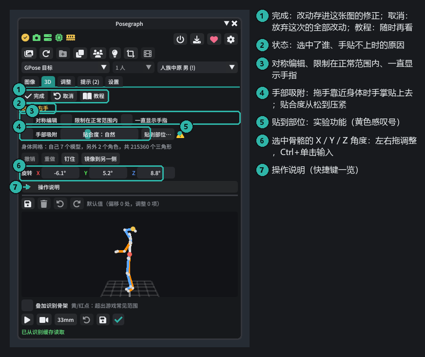

**控制点**

- **蓝色**是手和脚：拖它整条胳膊 / 腿跟着走（IK）。**绿色**是肘和膝：调弯的朝向。**白色**是骨盆、腰、胸、头：
  腰胸头转向鼠标，骨盆平移整个人。**紫色**是肩和脚尖。
- 选中手时会出现五根手指的点：指尖往掌心拖是握拳，往外拖是伸直。选中头时会出现视线点，拖它改眼睛看的方向。
- 点变黄 / 变红表示关节超出了游戏动画常见的范围；勾上「限制在正常范围内」会直接限住。

**操作**

- **单击**选中（外面多一圈橙色），**按住直接拖**是自由模式。拖动时按住 Shift 微调，右键取消这一下。
- 选中后按 **G 移动**、**R 旋转**，然后动鼠标；左键或回车确定，右键或 Esc 取消。可以直接敲数字：移动是厘米，旋转是度
  （例如 R、Z、9、0 就是绕 Z 转 90°）。
- **P** 钉住选中的手 / 脚（方框标记，之后动身体它不动；双脚默认钉住），**M** 把这一侧镜像到另一侧，勾「对称编辑」两边一起动。
  **Ctrl+Z / Ctrl+Y** 撤销 / 重做，**Esc** 取消选中。
- 改完点 **完成**：改动存进这张图的修正（关节朝向、整个人的位置、视线都存），下次打开这张图自动套上；点 **取消** 放弃这次的全部改动。

**锁轴和方向提示**

G 或 R 的时候按 **X / Y / Z** 锁住一根轴，这时画面上会画出方向提示：

- **第一次按是全局轴（实线）**：X 是角色的左右，Y 是上下，Z 是前后，和骨骼怎么歪都没关系。
- **同一个键再按一次是骨骼自身的轴（虚线）**：跟着这根骨骼的朝向走，比如沿着前臂拧手腕。第三次取消锁定。
- 一条贯穿画面的辅助线，节点旁画出这一组轴的三个方向（红 X、绿 Y、蓝 Z），锁住的那根带箭头和「+」号指着正方向，
  旁边写着是哪种轴。

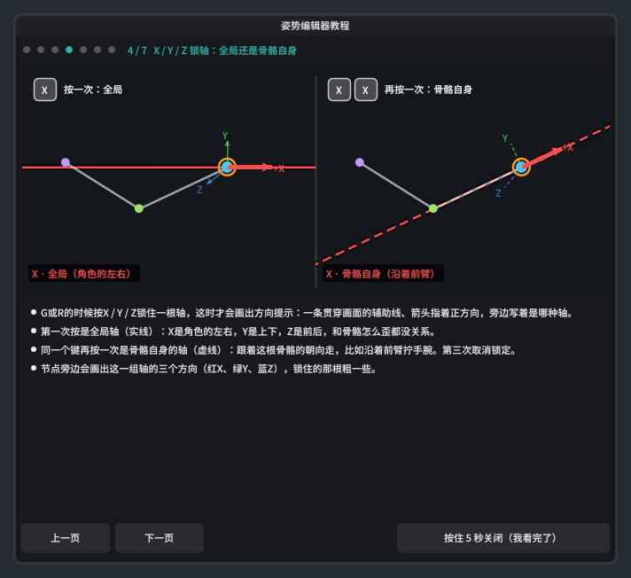

**看角度、输入角度**

- 旋转时节点周围画一个圈，扇形填充的部分就是转过的角度，旁边写度数；移动时一条虚线连着起点，旁边写移了多少厘米。
  鼠标旁边还显示这一下 X / Y / Z 各改了多少。
- 选中节点后，面板里的 **旋转 X / Y / Z** 是这根骨骼现在的角度（相对它的上一级骨骼，先绕 X、再绕 Y、再绕 Z）。
  按住数字左右拖可以调，Ctrl+单击直接输入，和 R 一样能撤销。

编辑器改的是这张图的修正，保存走的是后端：插件更新后记得在设置页 **更新后端**，不然视线和整个人的位置存不进去。

## 19. 手部吸附与「贴到部位」（实验）

摸脸、搭肩、叉腰、扶对方的手臂……手要贴在身上的姿势，单张照片很难识别准。编辑器里有两种办法让手贴上去：

- **手部吸附**：勾上后，拖手靠近身体（自己的，或 GPose 里别的角色），手掌会贴上去、手指顺着表面弯，手和手指不会钻进身体；
  绿色小圈是贴着的地方。拖动时按住 Alt 临时反转。**贴合度**从「松」（留一点缝）到「压紧」（手掌、指肚压进皮肤一点）；
  臀、胸、腹、大腿这些软的地方会自动多压一点。
- **贴到部位…**（实验功能，按钮旁有黄色感叹号）：选中一只手，点它，鼠标移到身上会高亮光标下的部位，点一下，这只手就自动贴过去。
  Esc 或右键取消。

「贴到部位」的推荐用法：**先把手大致摆到那附近、掌心朝着那里，再点「贴到部位」**。它只在你摆的基础上做小修正，
尽量保持你摆的手向和肘的位置，肘自然下垂；只动这条胳膊，不会去弯腰、转身。
够不着、或者要把手腕 / 肩拧到不自然才够得着时，它不会动，状态栏会说明原因（比如换另一只手、让两人靠近一些、先把手大致摆过去）。
不满意就 Ctrl+Z 撤销。

手贴着表面时按 **P** 是钉在表面上（菱形标记）：贴的是自己的身体时，之后转胸、弯腰手会跟着走。

## 20. 更新

- **插件**：通过插件仓库自动更新。更新后第一次打开主窗口会弹出更新日志。
- **后端**：插件更新后，设置页会提示后端版本。后端比插件旧时点旁边的下载按钮：下载同版本的后端代码，
  **新功能要的组件（面捕约 64MB、深度图约 400MB）缺哪个补哪个**，下载完会校验，不用重装后端。
  更新时会先停后端，装好后自动启动；新版起不来会自动换回旧版。连不上 GitHub 或者下载很慢时可以填「下载加速前缀」，
  中途断了再点一次就行，已经下好的组件不用重下。
- **插件里下载不了**：可以用浏览器从 GitHub 下载，或者找朋友要压缩包，自己解压进后端文件夹，见 [手动更新后端](../manual-update.zh-CN.md)。
- **要换 Python / PyTorch（插件会提示）、换了显卡、后端坏了**：再运行一次 `Install-Posegraph.bat`，选同一个文件夹，只补缺的、换不对的。

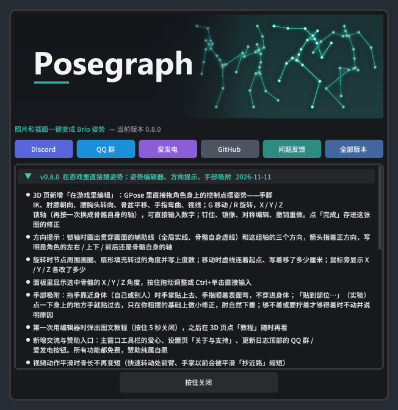

## 21. 常见问题

**识别很慢 / 显存不够**
设置页「识别设备」保持自动；显存不到 3GB 会自动用 CPU。CPU 识别每张约 10~20 秒，识别过的图会缓存。
「模型释放」改成「常驻」能省掉每次加载的时间，但会一直占着显存或内存。
「快速识别」默认开着（单人约 0.6 秒）；「深度辅助识别」能让镜头焦距和地面更准，但每张多约 0.5 秒、显存峰值多约 1.3GB，机器吃紧时可以关掉。

**后端启动后闪退，日志里有「Cannot create thread」「System error #1455」**
Windows 的内存（含虚拟内存）用完了：游戏本身就要占十几 GB。把虚拟内存（页面文件）调大或设成系统管理，
或者重启一次游戏、关掉暂时不用的程序再识别。

**手穿进身体 / 手没贴到头上**
调整页的「手部末端补偿」负责保持接触，可以调大「完全生效」距离。仍不理想时用「在游戏里编辑」把手拖过去，
勾上手部吸附或用「贴到部位」让手贴上（[第 19 节](#19-手部吸附与贴到部位实验)），也可以在 3D 页点选关节手动微调。

**「贴到部位」没反应，状态栏说够不着 / 转不过去**
它只动这条胳膊，不会为了够到去弯腰、拧关节。换另一只手，或者先把手大致摆到那附近、掌心朝着那里再点。

**编辑器里按 G / R 没反应**
先单击选中一个点（外面有橙色圈）；游戏或别的插件的输入框正在打字时，按键会交给输入框。

**腿或手的前后方向反了**
这是单张照片的深度歧义。挂一张侧面的辅助视角最有效；也可以在 3D 页手动调。

**跳跃的图被按到地上了**
调整页 → 站姿 → 关掉「自动贴地」。

**种族不对**
主窗口第三行最右边的种族下拉框手动指定（换种族 MOD、Customize+ 改体型时会出现）。

**手指不准**
装上 IVCS 骨骼手指会更准；没装时状态栏的 IVCS 图标是黄色，手指第三节的弯曲会合并到第二节。

还有问题欢迎到 [QQ 群](https://qm.qq.com/q/TGuxNR7auq)、[Discord](https://discord.gg/2z6KdPgacj) 或 [GitHub Issues](https://github.com/extrant/Posegraph/issues) 反馈。

## 22. 交流与赞助

Posegraph 所有功能都免费，赞助纯属自愿。插件里点主窗口右上角的 **爱心**，或者设置页最下面的 **关于与支持**：

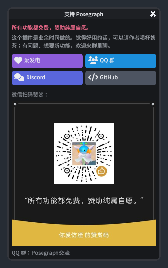

- QQ 群「Posegraph交流」：<https://qm.qq.com/q/TGuxNR7auq>
- Discord：<https://discord.gg/2z6KdPgacj>
- 爱发电：<https://afdian.com/a/Sincraft0515>
- 微信赞赏码：在「支持 Posegraph」窗口里扫码

---

### 示例图片来源

教程里的示例照片均为 CC0（公共领域），来自 Wikimedia Commons，已缩小：

| 文件 | 原图 |
|---|---|
| `images/sample-lean-wall.jpg` | [Arkansas woman poses (Unsplash)](https://commons.wikimedia.org/wiki/File:Arkansas_woman_poses_(Unsplash).jpg) |
| `images/sample-sit-wall.jpg` | [Smile in Air (Unsplash)](https://commons.wikimedia.org/wiki/File:Smile_in_Air_(Unsplash).jpg) |
| `images/sample-arms-open.jpg` | [Woman posing by drainpipe (Unsplash)](https://commons.wikimedia.org/wiki/File:Woman_posing_by_drainpipe_(Unsplash).jpg) |
| `images/sample-kalaripayattu.jpg` | [Kalaripayattu mock combat in rural Kerala](https://commons.wikimedia.org/wiki/File:Kalaripayattu_mock_combat_in_rural_Kerala.jpg) |
